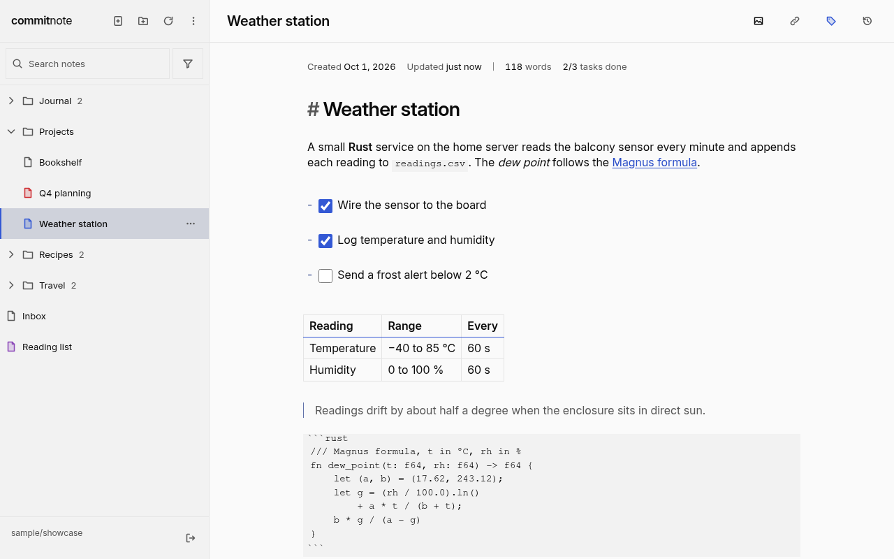
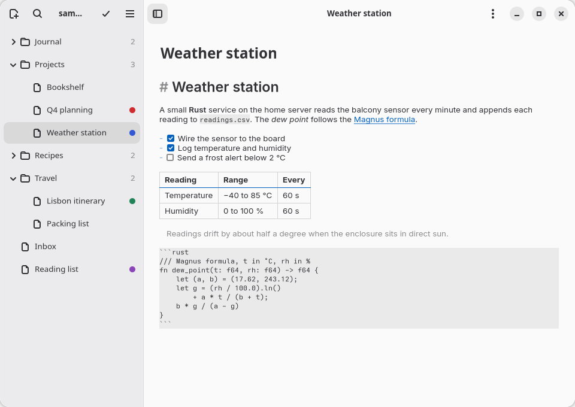
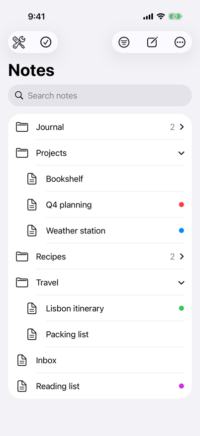

<h1 align="center">
  <picture>
    <source
      media="(prefers-color-scheme: dark)"
      srcset="docs/brand/wordmark-dark.svg"
    />
    
  </picture>
</h1>

<p align="center">Encrypted markdown notes in a GitHub or GitLab repository you own.</p>

<picture>
  <source media="(prefers-color-scheme: dark)" srcset="landing/screenshots/desktop-editor-dark@1x.png" />
  
</picture>

## Why

Most notes apps keep your notes on their own servers. commitnote keeps them in a git repository on
your own GitHub or GitLab account, encrypted before they leave your device. It's a markdown editor
with live preview, and there is no backend: the app only ever talks to GitHub or GitLab.

- Your passphrase derives the keys (Argon2id) and never leaves the device. Note contents are
  encrypted with AES-256-GCM, and file and folder names are encrypted too.
- Every save is one commit. The commit message is fixed text plus a few trailers, so it never
  contains a note's name or contents.
- Since it's git, every version is kept: open an earlier one and restore it. Deleted notes go to a
  trash first.
- Edits from several devices are merged without losing text. If two edits change the same lines,
  you pick one version or edit the merged text.

It also does images (converted to WebP on your device, GIFs kept as GIFs, metadata stripped, stored
encrypted), encrypted share links, search and zip import and export, and it has a Vim mode.

## Get it

<p>
  <picture>
    <source media="(prefers-color-scheme: dark)" srcset="landing/screenshots/linux-notes-dark@1x.png" />
    
  </picture>
  <picture>
    <source media="(prefers-color-scheme: dark)" srcset="landing/screenshots/ios-tree-dark@1x.png" />
    
  </picture>
</p>

### Web

Open [commitnote.eu/app](https://commitnote.eu/app/). It works in any current browser on desktop and
phone, and you can install it as an app from the browser (on iPhone: Share, then Add to Home Screen).
[commitnote.eu](https://commitnote.eu) is the landing page.

### Linux

A native GTK 4 and libadwaita app, shipped as a Flatpak for x86_64. It works on any desktop that
runs Flatpak (GNOME, KDE Plasma, sway, niri and so on). Download `commitnote-x86_64.flatpak` from the
[latest release](https://github.com/marcinjahn/commitnote/releases/latest), then:

```sh
flatpak remote-add --user --if-not-exists flathub https://dl.flathub.org/repo/flathub.flatpakrepo
flatpak install --user commitnote-x86_64.flatpak
flatpak run io.github.marcinjahn.commitnote
```

The first line adds Flathub, where the GNOME runtime comes from. There's no update channel yet: to
update, download the newer bundle and install it the same way. Each release also has a `SHA256SUMS`
file and a build provenance attestation:

```sh
sha256sum -c SHA256SUMS
gh attestation verify commitnote-x86_64.flatpak --repo marcinjahn/commitnote
```

App data lives in `~/.var/app/io.github.marcinjahn.commitnote/`. "Remember me" needs a keyring
(gnome-keyring, KWallet or KeePassXC); without one you log in again on every launch.

### iOS

There's a native SwiftUI app for iPhone and iPad (iOS 18 or newer), but it isn't on the App Store. CI builds an
unsigned IPA, and you can sideload it yourself with a free Apple ID. Nobody has installed it on a
real device yet, so treat this as experimental:

1. Download the `commitnote-unsigned-ipa` artifact from the latest green
   [iOS run](https://github.com/marcinjahn/commitnote/actions/workflows/ios.yml) on `main`. With a
   logged-in `gh`:

   ```sh
   gh run list -R marcinjahn/commitnote -w ios.yml -b main -s success -L 1   # first column is the run ID
   gh run download <run-id> -R marcinjahn/commitnote -n commitnote-unsigned-ipa
   ```

   Artifacts are kept for 30 days. If the latest one has expired, start a fresh build with
   `gh workflow run ios.yml -R marcinjahn/commitnote --ref main`.

2. Turn on Developer Mode on the device (Settings, Privacy & Security) and restart it.
3. Install [Impactor](https://github.com/claration/Impactor) (it's on Flathub as
   `dev.khcrysalis.PlumeImpactor`), plug the device in over USB, sign in with your Apple ID and
   install the IPA.
4. Trust your Apple ID under Settings, General, VPN & Device Management, then open the app.

Free signatures expire after 7 days; reinstalling over the old app keeps its data.

## First login

You need a private repository (empty, or holding only a README, LICENSE or .gitignore) and an
access token for it. On GitHub that's a fine-grained token with "Contents: read and write", plus
"Gists: read and write" if you want share links; the login screen has a link that opens GitHub's
token form with those already filled in. On GitLab (gitlab.com only for now) it's a personal access
token with the `api` scope. Paste the token, pick the repository, choose a passphrase, done.

A few things to know:

- There's no passphrase recovery. Lose it and the notes are gone.
- "Remember me" keeps the token and the derived keys (not the passphrase) in the browser profile, so
  anyone with access to that profile can read your notes. The installed web app always remembers.
- In a public repository the notes stay encrypted, but anyone can see how many files there are and
  how big they are.
- Removing an image from a note doesn't remove it from git history. Changing the passphrase with
  "Also delete the old history" does.

## Development

You need Node 26, npm and [just](https://just.systems) 1.55 or newer. Every task is a `just` recipe;
there are no npm scripts.

```sh
npm install
just dev            # http://localhost:5173
just                # lists every recipe, including the linux and ios modules
```

The ones you'll use most:

| Recipe                   | What it does                                                    |
| ------------------------ | --------------------------------------------------------------- |
| `just dev-fake`          | Dev server against in-memory fixture repos, no network          |
| `just check`             | svelte-check and tsc                                            |
| `just test`              | Vitest; `just test-related <files>` runs only the related tests |
| `just test-e2e`          | Playwright against the test-mode build                          |
| `just validate`          | `check`, `test`, `check-bundle` and `test-e2e` in turn          |
| `just build`             | Production site in `dist/`: landing at `/`, app at `/app/`      |
| `just build-native-core` | The core bundle the native apps run                             |

Recipe arguments go straight to the tool: `just test src/sync`, `just test-e2e e2e/login.spec.ts`.

In test mode (`just dev-fake`) any token works; `invalid-token` is rejected and
`no-repositories-token` sees no repositories. Log in to
`https://github.com/sample/notes` with the passphrase `sample notes repo passphrase`. Other fixtures
cover an empty repo (`sample/empty`), read-only and refused repos, a big tree (`sample/large-tree`)
and a GitLab stand-in (`https://fakelab.test/team/notes`); the full list is in
`src/testing/fake-forge/fake-forge-factory.ts`.

Some things that will bite you otherwise:

- WebCrypto needs a secure context. `localhost` is fine; the dev server over a LAN IP is not.
- `just test-e2e` installs Playwright's headless shell on first run and takes a machine-wide lock,
  so a second run waits for the first. `E2E_PORT` changes the port (default 4173). The installability
  test runs on the system Google Chrome.
- The brand SVGs and icons, the sample notes repo and the test vectors are generated
  (`just generate-*`), and tests fail when they go stale, so don't edit them by hand.
- The web screenshots in `landing/screenshots/` come from `just generate-landing-screenshots` and
  `just generate-pwa-screenshots`. The `ios-*` ones are the artifact of the "iOS screenshots"
  workflow, and `linux-notes-*` are copies of `apps/linux/data/screenshots/notes-*.png`.

### Layout

`src/` is the web app (Svelte 5, TypeScript, CodeMirror 6), `landing/` the landing page, `e2e/` the
Playwright specs. `apps/linux/` and `apps/ios/` are the native apps. Both run the same TypeScript
core (`src/native-core/`) in JavaScriptCore, so they read and write exactly what the web app does;
`apps/test-vectors/` holds the JSON vectors the TypeScript, Rust and Swift tests share.

### Linux app

Rust, GTK 4 and libadwaita, built with meson. Run `just build-native-core` first. Builds and tests
run in a Docker container, so you don't need any GTK development packages:

```sh
just linux build
just linux lint
just linux test                 # crate tests, UI suite under headless mutter, sway smoke run
just linux ui-test <filter>     # one UI case; screenshots land in apps/linux/out/screenshots
just linux install-prefix --testing && just linux run
just linux flatpak-build        # bundle in apps/linux/out/flatpak/
```

The `--testing` build runs against a fake forge with the sample repo, same as the web test mode.
`just linux run` starts the installed app on your machine, so that part needs the runtime packages
from `apps/linux/ci/run-packages.txt` and Fedora 45 or newer (GTK 4.24, libadwaita 1.10). To build
on the host as well, install the build packages too, plus rustup (it picks up
`apps/linux/rust-toolchain.toml`):

```sh
sudo dnf install $(cat apps/linux/ci/build-packages.txt apps/linux/ci/run-packages.txt)
just linux run-host
```

To release, say v0.3.0:

1. In one commit, bump `version` in `apps/linux/meson.build`, every crate's `Cargo.toml` and
   `Cargo.lock`, and add a `<release>` entry to
   `apps/linux/data/io.github.marcinjahn.commitnote.metainfo.xml.in`. `just linux lint` checks that
   they match, and the entry becomes the release notes.
2. Push and wait for the Linux workflow to pass.
3. Dry-run with `gh workflow run release.yml --ref main -f tag=v0.3.0` and check in
   `gh run list --workflow release.yml` that it ran on the commit you're about to tag.
4. Tag that commit and push only the tag: `jj tag set v0.3.0 -r <commit>`, then
   `jj git push --tag v0.3.0`.

The tag push builds the Flatpak, smoke-tests it and publishes it with its checksum and attestation.
Tags are never moved; a bad release gets a new patch version.

### iOS app

SwiftUI, with the project generated by XcodeGen. Apple builds only run in CI
(`.github/workflows/ios.yml`); push to an `ios-ci/<something>` branch to try a change on macOS
without touching `main`. On Linux you can still run the Swift package tests (`just ios swift-test`,
in Docker) and `just check-native-core`. On a Mac with Xcode 26:

```sh
brew install just xcodegen
npm ci
just build-native-core
just ios generate-project
open apps/ios/Commitnote.xcodeproj
```

### Deployment

Every push to `main` type-checks, runs the unit tests and the bundle check, then publishes `dist/` to
GitHub Pages at [commitnote.eu](https://commitnote.eu).

If a broken service worker ever ships, commit this as `public/sw.js`. The build ships it in place of
the generated worker; it clears commitnote's caches and unregisters itself. Delete the file again to
go back to normal.

```js
self.addEventListener("install", () => self.skipWaiting());
self.addEventListener("activate", (event) => {
  event.waitUntil(
    (async () => {
      for (const key of await caches.keys()) {
        if (key.startsWith("commitnote-")) await caches.delete(key);
      }
      await self.registration.unregister();
    })(),
  );
});
```

## License

No license yet, so all rights are reserved.
